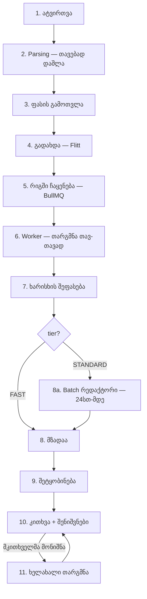

# Book Translator — თარგმნის ფლოუ

რა ეტაპებს გადის წიგნი ატვირთვიდან წაკითხვამდე.

---

## მოკლედ

---

## ეტაპები დეტალურად

### 1. ატვირთვა
მომხმარებელი ტვირთავს ფაილს — PDF, EPUB, DOCX ან TXT.
`POST /books/upload` → ორიგინალი ინახება S3-ზე.

### 2. Parsing — თავებად დაშლა
`parsing/` მოდული ფაილს კითხულობს და თავებად ჭრის.
თითოეულ თავს ეწერება `wordCount`.

**გვერდების რაოდენობა:** `pageCount = სულ სიტყვები / 250`
([books.service.ts:509](../../apps/api/src/books/books.service.ts:509))

ეს რიცხვი შემდეგ ფასის საფუძველია.

### 3. ფასის გამოთვლა
`GET /payment/pricing/:bookId` აბრუნებს ორ ვარიანტს — FAST და STANDARD.

`ფასი = max(pageCount × ტარიფი, PRICE_MIN)`

ტარიფები `.env`-ში: `PRICE_PER_PAGE_FAST`, `PRICE_PER_PAGE_SLOW`, `PRICE_MIN`.

### 4. გადახდა
Flitt-ის გვერდზე გადამისამართება → webhook ბრუნდება →
თანხა მოწმდება (`amount mismatch` შემოწმება) → `Translation` ჩანაწერი იქმნება.

### 5. რიგში ჩაყენება
BullMQ queue `translation`.
Job ID დეტერმინისტულია — `translate-{translationId}` — ამიტომ ორმაგი
enqueue თავად რიგმა უარყოს ("Retry"-ს დაწკაპუნება ორ worker-ს ვერ გაუშვებს).

Retry პოლიტიკა: 3 მცდელობა, exponential backoff 5 წმ-დან.

### 6. Worker — თარგმნა

Worker concurrency = **1**. ერთდროულად ერთი წიგნი ითარგმნება.

#### 6.0 სტილის ბრიფი (ერთხელ წიგნზე)
წიგნის დასაწყისი, შუა და ბოლო თავიდან 4,000-4,000 სიმბოლო →
Claude წერს ბრიფს: ჟანრი, რეგისტრი, თხრობის ხმა, მიმართვის ფორმები.
ეს ბრიფი ყველა შემდგომ prompt-ში ჯდება და ქეშირდება.

#### 6.1 თითოეულ თავზე

**ა) ტერმინების ამოღება (glossary)**
თავი იკითხება 12,000-სიმბოლოიან ფანჯრებად (მაქს. 4).
გამოიყოფა საკუთარი სახელები, ტოპონიმები, სპეციფიკური ტერმინები →
ინახება `glossary`-ში და გადაეცემა ყველა მომდევნო თავს.

> რატომ: მე-30 გვერდზე გამოჩენილი პერსონაჟი მე-200 გვერდზეც იმავე
> ფორმით უნდა დაიწეროს.

**ბ) დაჭრა chunk-ებად**
თავი იჭრება **12,000 სიმბოლოიან** ნაწილებად, ყოველთვის წინადადების
ბოლოში — არასდროს შუა სიტყვაზე.

**გ) თითოეული chunk ითარგმნება**

Claude-ს გადაეცემა:
- ქართული სტილის წესები + წიგნის სტილის ბრიფი *(ქეშირებული prefix)*
- მიმდინარე glossary
- **წინა chunk-ის ბოლო 1,500 სიმბოლო** — წყაროც და თარგმანიც
- მიმდინარე chunk

> რატომ ბოლო 1,500 სიმბოლო: chunk-ების ნაკერზე სტილი და ტერმინოლოგია
> რომ არ ,,გადავიდეს".

**დ) ვალიდაცია**
- თუ თარგმანი წყაროს **30%-ზე მოკლეა** → ჩავარდნილად ითვლება
- თუ მოდელმა `max_tokens` (16,000) ჩაარტყა → ტექსტი წყვეტილია

ორივე შემთხვევაში — **ერთი ხელახალი მცდელობა**.

**ე) რედაქტორის pass** *(მხოლოდ FAST tier)*
მეორე გამოძახება: Claude-ს ეძლევა ინგლისური წყარო + ქართული დრაფტი
და სთხოვს გასწორებას.

დაცვა: თუ რედაქტირებული ტექსტი დრაფტის ნახევარზე მოკლეა — დრაფტი რჩება.
თუ გამოძახება ჩავარდა — დრაფტი რჩება. რედაქტორის pass ვერასდროს
გააფუჭებს უკვე არსებულ თარგმანს.

**ვ) მექანიკური შემოწმება**
API გამოძახების გარეშე, დეტერმინისტულად: ხომ არ დარჩა უთარგმნელი
ინგლისური, ხომ არ არის ტექსტი ეჭვისმომგვრელად მოკლე და ა.შ.

**ზ) შენახვა**
თარგმანი → PostgreSQL (`chunk` საზღვრებთან ერთად) + S3.

> `segments` (chunk-ების საზღვრები) იმიტომ ინახება, რომ მოგვიანებით
> ზუსტად ვიპოვოთ რომელი წყარო რომელ თარგმანს შეესაბამება.

**თ) სიუჟეტის შეჯამება (rolling summary)**
თავის დასაწყისი 6,000 + ბოლო 3,000 სიმბოლო → მოკლე შეჯამება,
რომელიც წინა შეჯამებას ეკვრის და მომდევნო თავს გადაეცემა.

> რატომ: მე-20 თავმა უნდა იცოდეს რა მოხდა მე-5-ში.

**ი) პროგრესი**
`progress` ველი ახლდება **chunk-ის დონეზე**, არა თავის — ამიტომ
მომხმარებელი გლუვ პროგრეს-ბარს ხედავს და არა ნახტომებს.

### 7. ხარისხის შეფასება
- **მექანიკური:** ყველა თავის ანგარიში ჯამდება
- **LLM judge:** Gemini 2.5 Pro (განზრახ სხვა მოდელი) აფასებს **3 თავს** —
  პირველს, შუას, ბოლოს — თითოეულიდან 2,500 სიმბოლო.
  ქულები: სიზუსტე, სიგლუვე, თანმიმდევრულობა, საერთო (1-5).

შედეგი → `qualityScore` + `qualityReport`.

> ეს ეტაპი **არასდროს ჩააგდებს თარგმანს** — შეცდომა მხოლოდ ლოგდება.

### 8. სტატუსი COMPLETED
`progress = 100`, `status = COMPLETED`. მომხმარებელს უკვე შეუძლია კითხვა.

### 8a. Batch რედაქტორი *(მხოლოდ STANDARD tier)*
STANDARD-ს რედაქტორის pass **მიწოდების შემდეგ** უკეთდება, Anthropic-ის
Message Batches API-ით — **ნახევარ ფასად**.

- ყველა chunk ერთ batch-ად იგზავნება
- სტატუსი მოწმდება ყოველ 5 წუთში, მაქს. ~25 საათი
- როცა დაბრუნდება, გაუმჯობესებული ნაწილები **ტექსტში ჩაისმება ადგილზე**
- თუ batch ჩავარდა — მკითხველს დრაფტი რჩება, არაფერი ფუჭდება

> ეს არის ერთადერთი განსხვავება FAST-სა და STANDARD-ს შორის:
> **იგივე ხარისხი, ოღონდ 24 საათით გვიან და იაფად.**

### 9. შეტყობინება
Email (Resend) + Web Push + in-app + WebSocket.

### 10. კითხვა
Online Reader: bookmark-ები, highlight-ები, ჩანაწერები, პროგრესი.

### 11. ხელახალი თარგმანი
მკითხველი მონიშნავს პასაჟს და წერს, რა არის არასწორად.
→ ცალკე queue (`retranslation`), რომ მთავარ რიგს არ შეაფერხოს.

Claude-ს ეძლევა: წყარო + არსებული თარგმანი + პრეტენზია → ბრუნდება
ჩანაცვლება, რომელიც ტექსტში ჩაისმება.

**კვოტა: 30 გასწორება ერთ ნაყიდ თარგმანზე** (`RETRANSLATION_QUOTA`).
Retry — მხოლოდ 2 მცდელობა, რადგან ყოველი ცდა რეალური ხარჯია.

---

## რიგები (queues)

| Queue | რას აკეთებს | Concurrency | Retry |
|---|---|---|---|
| `translation` | ძირითადი თარგმნა | 1 | 3 |
| `editor-batch` | STANDARD-ის batch polling | — | 3 |
| `retranslation` | მკითხველის გასწორებები | — | 2 |

`editor-batch` ცალკე queue-ზეა იმიტომ, რომ `translation` concurrency 1-ითაა —
მრავალსაათიან თარგმანს მიღმა მდგარი poll job-ი ვერასდროს გაეშვებოდა.

---

## გამძლეობა (რა ხდება, როცა რამე ჩავარდება)

| ჩავარდნა | შედეგი |
|---|---|
| chunk-ის თარგმანი მოკლეა / წყვეტილი | ერთი ხელახალი მცდელობა |
| რედაქტორის pass ჩავარდა | დრაფტი რჩება |
| სიუჟეტის შეჯამება ჩავარდა | კონტექსტი კარგდება, თარგმანი გრძელდება |
| glossary ჩავარდა | თარგმანი გრძელდება ტერმინების გარეშე |
| Gemini judge ჩავარდა | ქულა არ ჩაიწერება, თარგმანი მზადაა |
| batch რედაქტორი ჩავარდა | მკითხველს დრაფტი რჩება |
| worker მოკვდა | 30 წუთის შემდეგ ადმინს შეუძლია Retry |

**პრინციპი:** მხოლოდ თავად თარგმნის ჩავარდნა აჩერებს პროცესს.
ყველა დანარჩენი ეტაპი დამხმარეა და მისი შეცდომა მხოლოდ ლოგდება.

---

## ძირითადი პარამეტრები

| პარამეტრი | მნიშვნელობა | სად |
|---|---|---|
| `MAX_CHUNK_SIZE` | 12,000 სიმბოლო | claude.service.ts |
| `CONTINUATION_TAIL_CHARS` | 1,500 | claude.service.ts |
| `MAX_OUTPUT_TOKENS` | 16,000 | claude.service.ts |
| `MIN_OUTPUT_RATIO` | 0.3 | claude.service.ts |
| `MAX_GLOSSARY_WINDOWS` | 4 | claude.service.ts |
| `JUDGE_SAMPLE_CHARS` | 2,500 | translation.processor.ts |
| `RETRANSLATION_QUOTA` | 30 | feedback.service.ts |
| მოდელი | `claude-sonnet-5` | `CLAUDE_MODEL` |
| judge მოდელი | `gemini-2.5-pro` | `GEMINI_JUDGE_MODEL` |

---

**იხ. ასევე:** [PRICING.md](PRICING.md) — რა ჯდება თითოეული ეტაპი.
